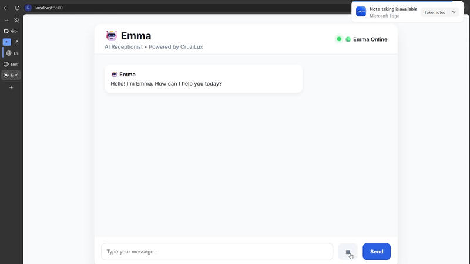

# Emma — AI Voice Receptionist

> A real-time, bilingual (English / German) AI receptionist that talks with customers by voice or text, answers questions about a business, and books appointments, built with **FastAPI, WebSockets and Google Gemini**.

Emma is the first "digital employee" of the **CruziLux AI Platform**. She works for one business at a time. Switching to a different business means editing a JSON file, not rewriting code.

---

## Demo

<p align="center">
  
</p>

<p align="center"><em>Emma's web interface: she greets the customer, who can type a message or press the 🎤 button to speak.</em></p>

---

## What it does

A customer opens the web page and either types or presses the 🎤 button and speaks. Emma:

1. **Understands speech.** Browser audio is streamed to the backend and transcribed with Gemini.
2. **Detects the language.** She replies in English or German and stays in that language unless the customer asks to switch.
3. **Answers as the business.** Opening hours, services and contact details come from the company profile. She doesn't make up prices or availability.
4. **Books an appointment.** She collects the service, date, time, name, phone and email, reads them back, and confirms each one before booking.
5. **Speaks the reply.** The answer is streamed back as audio with Gemini text-to-speech and plays while it is still being generated.

```
Customer:  "Hi, can I book a cleaning for tomorrow afternoon?"
Emma:      "Of course! What time tomorrow afternoon works best for you?"
Customer:  "Kann ich das auf Deutsch machen?"
Emma:      "Natürlich! Um wie viel Uhr morgen Nachmittag passt es Ihnen am besten?"
```

---

## Why this project is worth a look

| Area | What it shows |
|---|---|
| **Real-time systems** | One WebSocket carries both text (JSON) and binary audio in each direction. TTS audio is streamed as PCM16 chunks and scheduled gaplessly with the Web Audio API. |
| **LLM engineering** | One Gemini call returns **structured JSON** (`state_updates` + `response`), so understanding the message and writing the reply happen in a single round trip. Requests have timeouts and bounded retries. |
| **Reliability around the LLM** | *"Gemini understands, Python decides."* The LLM extracts facts, and a **deterministic state machine** controls the booking. Past dates are rejected, a changed detail means re-confirming, and phone/email are validated before anything is booked. |
| **Multilingual design** | Rule-based EN/DE language detection with an "explicit switch only" policy, so a German name or a noisy transcription doesn't flip the language. TTS uses the matching speech language. |
| **Configurable product** | The system prompt is a template filled in from `company.json`. The same engine can run a dental clinic, a barber or a hotel. |
| **Performance awareness** | LRU cache for repeated TTS phrases, latency logging for each stage (STT / LLM / TTS), and audio that starts playing before generation finishes. |
| **Product thinking** | Written vision, principles, an architecture decision log and milestones in [`docs/`](docs/). |

---

## Architecture

```
┌──────────────────────── Browser (vanilla JS) ─────────────────────────┐
│  Text input ─┐                                   ┌─► Chat UI          │
│  🎤 MediaRecorder (webm/opus) ─┐                 ├─► Booking card     │
│                                │                 └─► Web Audio player │
└────────────────────────────────┼───────── ▲ ──────────────────────────┘
                                 │ /ws/voice│  (JSON text + PCM16 bytes)
┌──────────────────────── FastAPI backend ─┼─────────────────────────────┐
│                                ▼         │                             │
│   SpeechService ── Gemini (speech → text)│                             │
│        │                                 │                             │
│        ▼                                 │                             │
│   ConversationManager  (one per connection)                            │
│     ├─ Language detection (EN/DE, deterministic)                       │
│     ├─ PromptManager ◄── company.json + system_prompt.md               │
│     ├─ RuntimeContext (date/time in the company's timezone)            │
│     ├─ GeminiService ── structured JSON {state_updates, response}      │
│     └─ Booking state machine                                           │
│          collecting → confirming → ready_for_contact →                 │
│          verifying_phone → verifying_email → confirmed                 │
│        │                                 │                             │
│        ▼                                 │                             │
│   VoiceService ── Gemini TTS (streamed PCM, LRU-cached) ───────────────┘
└────────────────────────────────────────────────────────────────────────┘
```

---

## Tech stack

- **Backend:** Python 3.11+, FastAPI, Uvicorn, WebSockets, `google-genai`
- **AI models (Gemini):** Flash for chat and transcription, native TTS for the voice. Model names are set through environment variables.
- **Frontend:** Plain HTML/CSS/JavaScript (ES modules), MediaRecorder API, Web Audio API. No framework and no build step.

---

## Project structure

```
Cruzilux-emma-ai/
├── backend/
│   ├── app/
│   │   ├── main.py                    # FastAPI app
│   │   ├── config.py                  # Settings from .env
│   │   ├── config/company.json        # Active business profile
│   │   ├── routes/voice.py            # /ws/voice WebSocket endpoint
│   │   ├── core/
│   │   │   ├── conversation_manager.py  # Language, state, booking workflow
│   │   │   ├── prompt_manager.py        # Builds the system prompt
│   │   │   ├── company_manager.py       # Loads the company profile
│   │   │   └── runtime_context.py       # Timezone-aware date/time
│   │   ├── ai/
│   │   │   ├── gemini_service.py        # LLM call → structured JSON
│   │   │   ├── speech_service.py        # Speech-to-text
│   │   │   └── voice_service.py         # Streaming TTS + cache
│   │   └── prompts/system_prompt.md   # Emma's personality and rules
│   └── requirements.txt
├── frontend/
│   ├── index.html
│   ├── css/styles.css
│   └── js/  app.js · websocket.js · audio.js · ui.js
├── business_profiles/                 # Planned: clinic / barber / hotel demos
└── docs/                              # Vision, architecture, decisions, roadmap
```

---

## Getting started

**Requirements:** Python 3.11+, a [Gemini API key](https://aistudio.google.com/apikey), and Chrome or Edge (for microphone and Web Audio).

### 1. Backend

```bash
cd backend
python -m venv .venv
# Windows:  .venv\Scripts\activate
# macOS/Linux: source .venv/bin/activate
pip install -r requirements.txt
```

Create `backend/.env`:

```env
GEMINI_API_KEY=your_key_here

# Optional overrides
CHAT_MODEL=gemini-flash-latest
TTS_MODEL=gemini-3.8-flash-tts
DEFAULT_VOICE=Aoede
```

Start the server **from inside `backend/`** (the config files are loaded with relative paths):

```bash
uvicorn app.main:app --reload --port 8000
```

### 2. Frontend

```bash
cd frontend
python -m http.server 5500
```

Open **http://localhost:5500**, allow microphone access, and start talking to Emma.

### 3. Make Emma work for a different business

Edit `backend/app/config/company.json`:

```json
{
  "company_name": "SmileCare Dental",
  "company_type": "Dental Clinic",
  "timezone": "Europe/Vienna",
  "opening_hours": "Monday to Friday, 8:00 AM to 6:00 PM",
  "services": ["Dental checkups", "Teeth cleaning"],
  "instructions": ["Do not invent prices."]
}
```

Restart the backend and Emma now represents that business.

---

## Project status

This is a working **demo / MVP**. Bookings are simulated: a confirmation ID is generated and shown in the UI, but nothing is saved and no email is sent.

**Working now**
- Text and voice conversation over WebSocket
- English and German with persistent language choice
- Full booking flow with read-back and contact verification
- Streaming TTS with caching

**Next up** (see [docs/08_Roadmap.md](docs/08_Roadmap.md))
- Automated test suite and CI
- Async Gemini calls so several users can talk at the same time
- Persistent bookings (database) and calendar integration
- Loading business profiles from `business_profiles/`
- Interruptible speech and lower end-to-end latency
- Deployment (Docker, `wss://`, configurable backend URL)

---

## Design principles

> **Build with purpose. Design for people. Scale with principles.**

- Customer experience first. Emma should sound like a great receptionist, not a chatbot.
- Never hallucinate. If Emma doesn't know something, she says so.
- One company at a time. Never mix business information.
- The LLM handles language, and code handles decisions.

The full reasoning is in [`docs/`](docs/00_README.md).

---

## Author

Built by **Jezl** as part of **CruziLux**.
